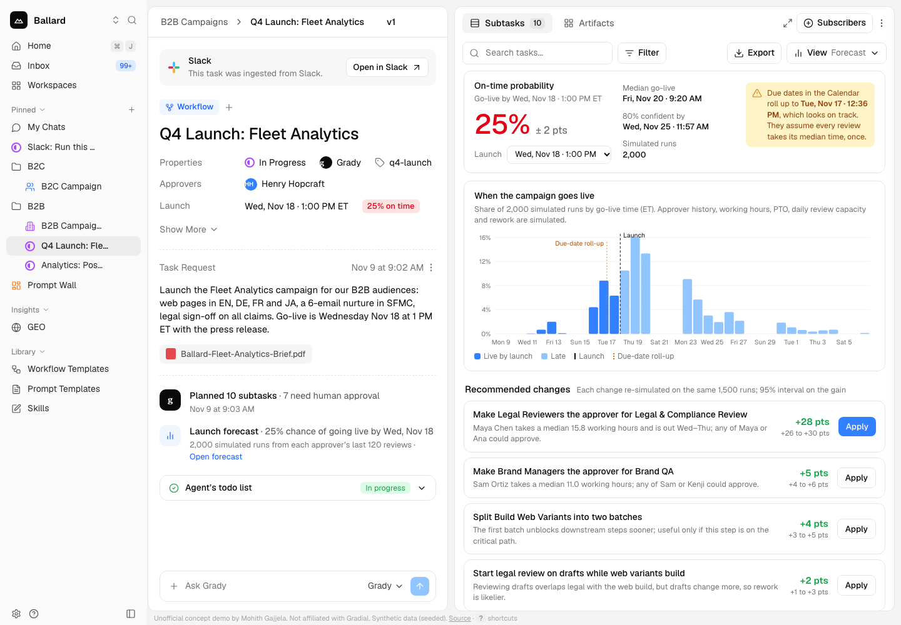

# Launch Forecast for Gradial workflows

**Live demo:** https://mohith26.github.io/gradial-launch-forecast/

Gradial's agents finish their part of a campaign in minutes; the launch date is set by the humans in between: legal, brand, localization and web leads, each with their own queue, time zone, PTO and habit of sending work back. Gradial's September task redesign gives every campaign a Canvas, a Table with dependencies and a Calendar of due dates, and its new group approvers exist "so reviews never wait on one person's availability". Launch Forecast adds a **Forecast** view next to them. It simulates the workflow 2,000 times, drawing each review time from that approver's own history in their working hours, and answers three questions: what are the odds this campaign goes live on time, which steps are setting the date, and which change (usually "make a group the approver") buys the most probability, with a confidence interval on the gain.



## Results

All numbers come from `node scripts/backtest.mjs`, written to [`results/summary.json`](results/summary.json) and re-checked in CI.

**Backtest: 400 simulated past campaigns.** Each campaign is forecast at kickoff from the approvers' review history, then played out once under a hidden ground truth that the forecaster does not model directly (reviews landing on a Friday take 1.6× longer, 3% surprise days off, other campaigns using up to half of each reviewer's daily capacity).

| | Launch Forecast | Due-date roll-up (every step at its median, once) |
|---|---|---|
| Late launches flagged in advance | **233 / 261 (89%)** given under 50% | 118 / 261 (45%) called on track |
| Brier score (lower is better) | **0.122** | 0.300 |
| Average calibration gap | 5.4 pts (slightly pessimistic: 31% forecasts came true 43% of the time) | n/a |

**The demo campaign** ("Q4 Launch: Fleet Analytics", 10 subtasks, 7 human approvals, go-live Wed Nov 18 1:00 PM ET):

| | |
|---|---|
| Due-date roll-up | Tue Nov 17, ~12:36 PM (looks a day early) |
| Forecast | **25%** on time (95% CI 23–27%), median go-live Fri Nov 20 |
| Best change | Make *Legal Reviewers* the approver for Legal & Compliance Review: **+28 pts** (95% CI +26 to +30) |
| Then | Make *Brand Managers* the approver for Brand QA: +5 pts |
| After both | 64% on time |

The whole pipeline (history, 400-campaign backtest, scenario forecast and five what-ifs) runs in under 5 s in Node; the page computes its forecast in the browser in about half a second.

## How it works

`src/forecast.js` (pure functions, shared by the page, the scripts and the tests):

1. **Calendar.** Time is in hours from Monday 00:00 ET. Each person works Mon–Fri 9–18 in their own time zone and skips PTO days. `addWorkingHours` and `workingHoursBetween` convert between wall-clock and working time.
2. **Approver models from history.** From each approver's last 120 decisions (request time, decision time, approve/reject), the forecaster keeps the empirical distribution of review times in working hours and a Beta posterior on the send-back rate. Review times are drawn by a smoothed bootstrap, so heavy tails and Friday effects present in the history come along without being modelled.
3. **Simulation.** Steps run in dependency order. Agent work runs around the clock (lognormal). A review starts at the approver's next working moment, takes a bootstrapped number of working hours, respects a daily review capacity (a reviewer who clears three a day pushes the fourth to tomorrow), and with the sampled send-back probability loops through agent rework and a faster re-review (up to 4 rounds). A group approver finishes when its fastest member does.
4. **Outputs.** P(on time) with a Wilson interval, P50/P80/P95 go-live, per-step finish quantiles, and each step's criticality (share of runs where it sat on the path that set the go-live time, recovered by back-tracking the latest dependency).
5. **What-ifs with common random numbers.** Every random draw is keyed by (run, step, person, round), so a variant plan sees the same luck as the baseline. The gain in P(on time) is a paired difference with a 95% interval, which is several times tighter than comparing two independent forecasts (tested). Only changes whose interval excludes zero get a highlighted Apply button.
6. **Backtest.** `scripts/backtest.mjs` generates history and 400 campaigns from the hidden truth, forecasts each, plays it out, and reports calibration, Brier score and the roll-up comparison.

## The demo app

- Gradial's task page rebuilt: sidebar, task home (Slack source, properties, request, activity feed, agent to-do, Ask Grady), and the Subtasks panel with a **View** menu that now has **Forecast** next to **Table**.
- **Forecast view:** on-time probability, the due-date roll-up warning, the go-live distribution with launch and roll-up markers, recommended changes with **Apply** (state change, persisted in `localStorage`, undo chips), the "what's driving it" table, and the calibration backtest.
- **Drill-down:** click a subtask (or open `#/step/s5`) for its criticality, finish quantiles and each approver's review-time histogram, send-back rate with a 95% interval, capacity, time zone and PTO.
- Launch date what-if, CSV export, deep links (`#/forecast`, `#/table`, `#/step/<id>`), keyboard shortcuts (`f`, `t`, `j`/`k`, `a`, `u`, `e`, `?`), loading and error states.

Design tokens come from app.gradial.com's production CSS: Geist and Geist Mono, `--primary #3080ff`, review purple `#ac4bff`, `--radius .625rem`, borders `#e5e5e5`, muted `#f5f5f5`/`#737373`, sidebar `#fafafa`, the orange Task chip and pink Agentic chip, and Lucide icons. Layout and copy follow the screenshots in Gradial's 9/28/26 release notes.

## Honest limitations

- **All data is synthetic.** People, histories and the campaign are generated by `src/scenario.js` from stated assumptions (medians 5–14 working hours, legal slow and heavy-tailed, 10–28% send-back rates). The backtest's "truth" is also a model; it is deliberately harsher than the forecaster, but it is not real Gradial data.
- The forecaster is slightly pessimistic in the middle bins (forecasts of 31% and 51% came true 43% and 63% of the time) because history-level slowdowns are applied to every review. Real histories would let it condition on weekday and queue length.
- Approver behaviour is treated as stationary over the last 120 decisions; a new approver with little history falls back to a wide prior.
- The action set is small and hand-picked (group approvers, early legal review, batch splits). A real version would search over Gradial's own groups and workflow templates.
- Kanban, Canvas and Calendar views are not rebuilt in this demo; Table and Forecast are.

## Prior art and what is new

Monte Carlo schedule risk analysis is old (PERT, Monte Carlo SRA in project controls), and throughput-based Monte Carlo forecasting exists for agile teams (e.g. ActionableAgile). Work-management tools offer deterministic projected dates (Adobe Workfront) or heuristic "at risk" flags. I did not find a tool, or anything in Gradial's docs and release notes, that forecasts an agentic content workflow from **each approver's own review history in working hours, with PTO, daily capacity and send-back loops**, and ranks changes in Gradial's own terms (group approvers) with paired, common-random-number confidence intervals and a published calibration backtest. That combination is the new part.

## Run it

```sh
node scripts/backtest.mjs      # regenerates results/summary.json and results/backtest.json
node --test test/*.test.mjs    # 14 tests incl. two randomized property tests and the headline check
python3 -m http.server 8000    # then open http://localhost:8000
```

No dependencies and no build step.

---
Unofficial concept demo by Mohith Gajjela. Not affiliated with Gradial. Synthetic data (seeded).
